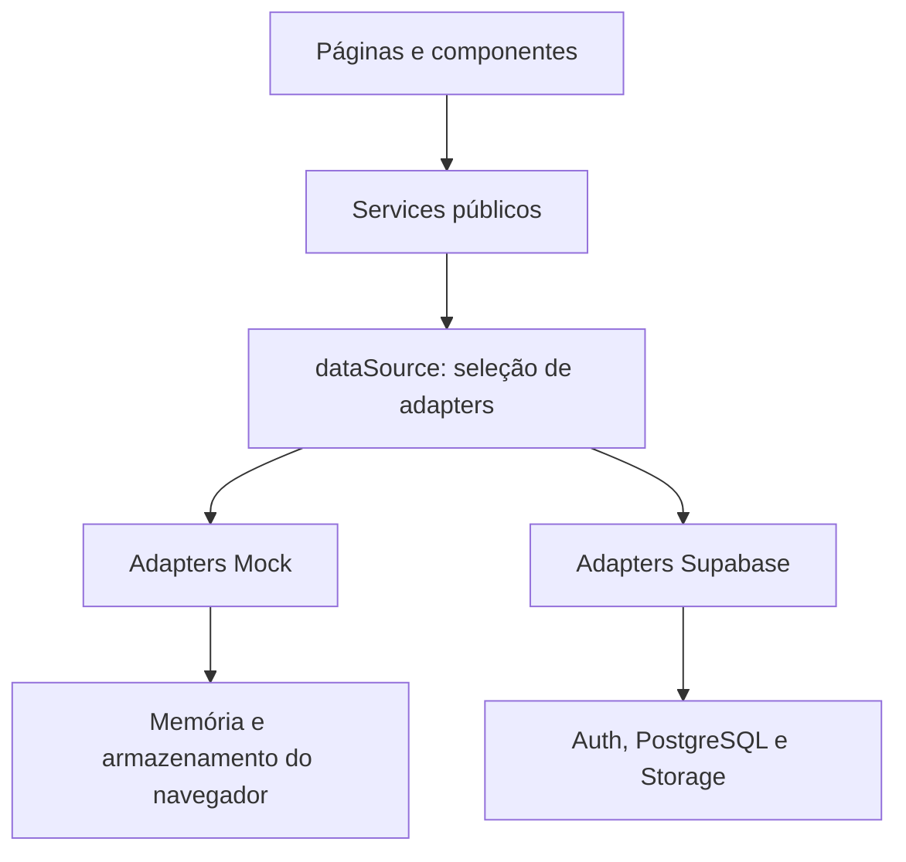

# 04 — Arquitetura

## Visão técnica

O e-Writter é uma aplicação de páginas HTML com JavaScript ES Modules executado no navegador. Não há framework frontend, etapa de build, servidor próprio da aplicação ou funções server-side versionadas neste checkout. O backend real usa Supabase Auth, PostgreSQL e Storage; o modo Mock mantém dados no navegador.



## Organização existente

```text
.
├── assets/                     # diretórios reservados de imagens e ícones
├── css/                        # base, componentes e estilos por página
├── docs/                       # documentação especializada
├── js/
│   ├── components/             # navegação, sessão, cards e feedback
│   ├── pages/                  # controladores e regras locais de publicação
│   ├── services/               # sete fachadas, dataSource e cliente Supabase
│   │   └── adapters/
│   │       ├── mock/
│   │       └── supabase/
│   └── validation/             # sintaxe de e-mail compartilhada
├── supabase/
│   ├── config.toml
│   └── migrations/             # schema e políticas versionados
├── tests/                      # suítes Node, helpers e scripts de navegador
├── index.html
├── login.html / cadastro.html
├── recuperar-senha.html / redefinir-senha.html
├── perfil.html / meuslivros.html / biblioteca.html
├── book-editor.html / chapter-editor.html
├── detalhes-obra.html / chapter.html
└── package.json
```

O agrupamento de HTMLs no desenho acima é apenas visual: todos esses arquivos ficam na raiz. Não existem páginas próprias de busca, autor ou 404 nem arquivo `supabase/seed.sql`. A configuração local ainda referencia esse seed ausente; a implicação operacional está em [12-Deploy-e-Ambientes.md](12-Deploy-e-Ambientes.md).

## Fronteiras e responsabilidades

| Parte | Responsabilidade |
|---|---|
| `js/pages/` | Associar DOM/eventos aos casos de uso, gerenciar seleção, carregamento e navegação. |
| `js/components/` | Criar cards/controles e compartilhar feedback, links e ciclo de sessão. |
| `js/services/` | Exportar assinaturas consumidas pela interface e delegar sem transformar o retorno. |
| `js/services/dataSource.js` | Escolher um conjunto de adapters na importação. |
| `js/services/adapters/` | Executar consultas, validar entradas, aplicar regras específicas e normalizar dados/erros. |
| `js/services/supabaseClient.js` | Inicializar uma instância do SDK importado de CDN. |
| `js/validation/email.js` | Política sintática de e-mail usada no Mock e na recuperação. |

Páginas e componentes importam services, não adapters nem o cliente Supabase. O contrato completo, incluindo os dois nomes de erro genérico, está em [14-Contrato-Front-Services.md](14-Contrato-Front-Services.md).

## Seleção de fonte e endpoint

A fonte é calculada uma vez ao carregar `dataSource.js`; alterar apenas a query de um documento já carregado não troca seu adapter. Todos os adapters são importados estaticamente: mesmo no Mock, o grafo importa o SDK remoto. Portanto, Mock não significa operação offline garantida.

Fonte e endpoint são escolhas diferentes: `dataSource.js` escolhe Mock/Supabase e `supabaseClient.js` escolhe endpoint local/remoto pelo hostname. A matriz definitiva de URLs e execução fica em [12-Deploy-e-Ambientes.md](12-Deploy-e-Ambientes.md).

## Persistência Mock

| Conjunto | Armazenamento e ciclo |
|---|---|
| Contas e perfis | `localStorage`, chave `e-writter-mock-identity-v1`; snapshot versão 1 com contas projetadas e perfis, validado a cada leitura. |
| Sessão | `sessionStorage`, chave `e-writter-mock-user`; novas sessões guardam `{ id, expires_at }`, com uma hora de validade. Snapshots legados com somente ID ainda são aceitos. |
| Catálogo | Arrays compartilhados de `mockData.js`, restaurados de `e-writter-mock-library-v1` no `localStorage`; salva obras, gêneros associados e capítulos. |
| Favoritos | `localStorage`, chave `e-writter-mock-favorites-v1`; relações distinguem `userId`. |
| Arquivos de capa | IndexedDB `e-writter-mock-covers`, store `covers`; os metadados mantêm apenas o caminho lógico. |
| Avatar Mock | Alteração do perfil fixture em memória; não é upload nem persistência no snapshot de identidade. |

Identidade não serializa senhas originais: utiliza verificadores cuja proteção/limitações estão em [11-Seguranca.md](11-Seguranca.md). Uma escrita de identidade relê o snapshot, aplica alteração síncrona, valida e confirma a persistência antes de retornar sucesso. Web Locks serializa entre abas quando disponível; sem essa API não há transação garantida entre abas.

A criação da conta e o início da sessão usam APIs distintas: falha de `sessionStorage` pode ocorrer após salvar a conta. Erros de identidade são propagados; catálogo e favoritos absorvem falhas de persistência e podem continuar apenas em memória. A exclusão técnica de capítulo Mock não chama a persistência do catálogo. Essas diferenças impedem tratar Mock como réplica integral do banco.

## Sessão e resultados assíncronos

`auth-navigation.js` apresenta verificação, visitante, autenticado ou erro. `session-status.js` compartilha falhas detectadas pelas páginas com o menu, sem armazenar outra sessão.

`session-boundary.js` protege as páginas privadas com tokens de geração, revalidação da identidade e limpeza em eventos de Auth/`pagehide`. A restauração com `pageshow.persisted` agenda nova carga. Operações antigas não devem repor dados ou liberar botões pelo `finally`.

`favorite-session.js` coordena controles montados com uma assinatura e um `WeakMap`. Consultas após eventos de Auth são agendadas fora do callback do SDK. Essas barreiras protegem a apresentação; não cancelam requisições nem desfazem uma gravação já autorizada no servidor.

## Integração e efeitos de mutação

Criação de obra com gêneros e despublicação usam RPCs no Supabase. Outras operações atualizam tabelas sob RLS; uploads usam Storage e depois atualizam referências. Edição de metadados/gêneros e operações de imagem podem envolver chamadas separadas, sem rollback conjunto. O consumidor deve distinguir falha total de salvamento parcial.

Schema/integridade: [05-Modelo-de-Dados.md](05-Modelo-de-Dados.md). Autorização: [11-Seguranca.md](11-Seguranca.md). Motivos das escolhas: [13-Decisoes-Tecnicas.md](13-Decisoes-Tecnicas.md).
