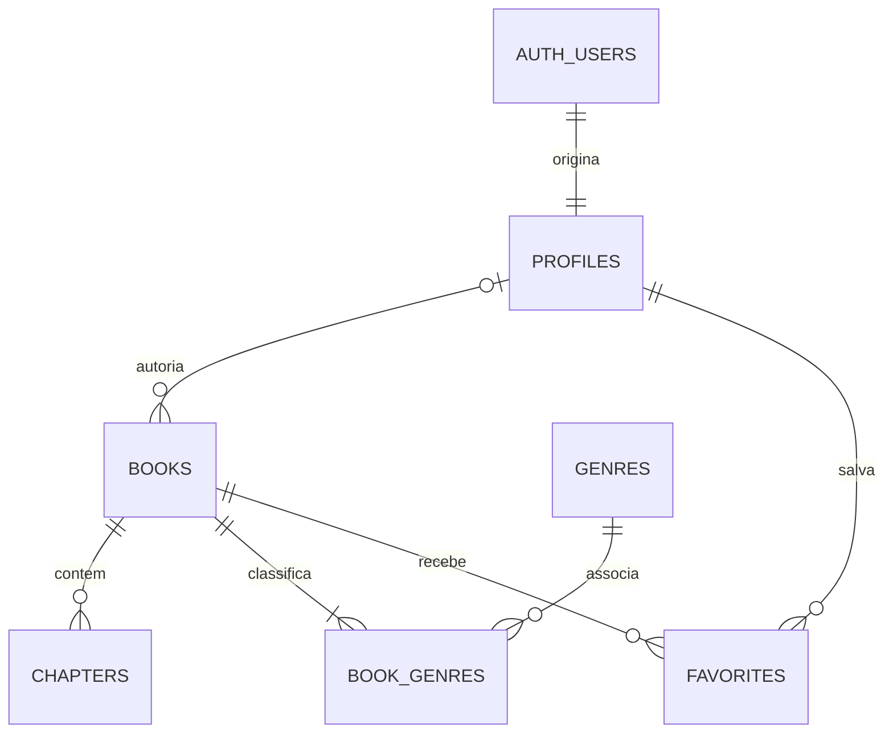

# 05 — Modelo de Dados

## Referência e limites

O schema abaixo deriva das 12 migrations em [supabase/migrations](../supabase/migrations/), aplicadas em ordem de nome, de `20260825123210_create_profiles.sql` a `20261025210000_grant_mvp_table_privileges.sql`. A auditoria descreve o SQL versionado; não executou migrations nem certificou o estado do banco remoto.

Modelos em camelCase pertencem a [14-Contrato-Front-Services.md](14-Contrato-Front-Services.md); permissões/RLS, a [11-Seguranca.md](11-Seguranca.md).

## Relações

O trigger de cadastro mantém a relação esperada entre Auth e perfil no fluxo normal; a FK, isoladamente, só exige que um perfil tenha uma conta. Uma obra admite zero ou um autor vinculado. Deve manter de uma a três relações de gênero nas operações previstas.

## Tabelas e campos

### `profiles`

| Campo | Tipo | Restrição/default |
|---|---|---|
| `id` | `uuid` | PK e FK para `auth.users(id)` |
| `username` | `text` | Obrigatório, único, 3–30 caracteres, minúsculo, aparado e padrão `[a-z0-9._]+` |
| `display_name` | `text` | Obrigatório, 1–60 caracteres e aparado |
| `bio` | `text` | Nulo ou até 500 caracteres |
| `avatar_path` | `text` | Opcional, sem validação de formato na coluna |
| `created_at` | `timestamptz` | Obrigatório, `now()` |
| `updated_at` | `timestamptz` | Obrigatório, `now()`, atualizado por trigger |

São dados de perfil públicos no modelo atual; e-mail, senha e sessão não são colunas desta tabela.

### `books`

| Campo | Tipo | Restrição/default |
|---|---|---|
| `id` | `uuid` | PK, `gen_random_uuid()` |
| `author_id` | `uuid` | FK anulável para `profiles(id)` |
| `title` | `text` | Obrigatório e não vazio após `btrim` |
| `description` | `text` | Opcional no rascunho |
| `cover_path` | `text` | Opcional, sem validação de formato na coluna |
| `status` | `text` | Obrigatório, `draft`; CHECK em `draft`/`published` |
| `publication_status` | `text` | Obrigatório, `ongoing`; CHECK em `ongoing`/`completed`/`discontinued` |
| `language` | `text` | Obrigatório, `pt-BR`; sem CHECK de domínio ou texto não vazio |
| `published_at` | `timestamptz` | Nulo em rascunho, mantido por trigger |
| `created_at` | `timestamptz` | Obrigatório, `now()` |
| `updated_at` | `timestamptz` | Obrigatório, `now()`, atualizado por trigger |

Não há limite de 180 caracteres no banco para título; esse limite pertence ao campo do ateliê. Autoria anulável permite preservar uma obra na remoção do perfil, mas não implementa o fluxo de exclusão de conta nem descontinuação automática.

### `chapters`

| Campo | Tipo | Restrição/default |
|---|---|---|
| `id` | `uuid` | PK, `gen_random_uuid()` |
| `book_id` | `uuid` | Obrigatório, FK para `books(id)` |
| `title` | `text` | Anulável em rascunho |
| `content` | `text` | Anulável em rascunho |
| `status` | `text` | Obrigatório, `draft`; CHECK em `draft`/`published` |
| `position` | `integer` | Obrigatório, positivo e único por obra; atribuído por trigger |
| `published_at` | `timestamptz` | Nulo em rascunho, mantido por trigger |
| `created_at` | `timestamptz` | Obrigatório, `now()` |
| `updated_at` | `timestamptz` | Obrigatório, `now()`, atualizado por trigger |

A constraint `uq_chapters_book_position` garante unicidade, não continuidade por si só. A sequência decorre da atribuição ao final, da imutabilidade de posição/vínculo e da exclusão da cauda. Publicação não exige que as posições anteriores estejam publicadas.

### `genres`

| Campo | Tipo | Restrição/default |
|---|---|---|
| `id` | `integer` | PK, `GENERATED ALWAYS AS IDENTITY` |
| `name` | `text` | Obrigatório e único |
| `slug` | `text` | Obrigatório e único |

Carga inicial na migration `20260912222013_create_genres.sql`:

| Nome | Slug |
|---|---|
| Ação | `acao` |
| Aventura | `aventura` |
| Comédia | `comedia` |
| Drama | `drama` |
| Fantasia | `fantasia` |
| Ficção Científica | `ficcao-cientifica` |
| Mistério | `misterio` |
| Romance | `romance` |
| Suspense | `suspense` |
| Terror | `terror` |
| Ficção Histórica | `ficcao-historica` |
| Fanfic | `fanfic` |

Os gêneros são populados pela migration, não por um seed separado.

### `book_genres`

| Campo | Tipo | Restrição |
|---|---|---|
| `book_id` | `uuid` | Obrigatório, FK para `books(id)` |
| `genre_id` | `integer` | Obrigatório, FK para `genres(id)` |

PK composta `pk_book_genres(book_id, genre_id)` impede repetição. A quantidade de relações é protegida por triggers e pelas operações de criação/substituição descritas abaixo.

### `favorites`

| Campo | Tipo | Restrição/default |
|---|---|---|
| `user_id` | `uuid` | Obrigatório, FK para `profiles(id)` |
| `book_id` | `uuid` | Obrigatório, FK para `books(id)` |
| `created_at` | `timestamptz` | Obrigatório, `now()` |

PK composta `pk_favorites(user_id, book_id)` impede duplicidade. Despublicar obra não remove essa relação.

## Chaves estrangeiras e exclusões

| FK | Ação na exclusão da origem referenciada |
|---|---|
| `profiles.id → auth.users.id` | `CASCADE`: remove o perfil |
| `books.author_id → profiles.id` | `SET NULL`: conserva a obra com autoria nula |
| `chapters.book_id → books.id` | `CASCADE` |
| `book_genres.book_id → books.id` | `CASCADE` |
| `book_genres.genre_id → genres.id` | `RESTRICT`: gênero utilizado não pode ser removido |
| `favorites.user_id → profiles.id` | `CASCADE` |
| `favorites.book_id → books.id` | `CASCADE` |

Arquivos do Storage não participam dessas FKs. Excluir uma obra no banco não remove automaticamente o arquivo de capa.

## Funções e triggers vigentes

| Função | Acionamento/finalidade |
|---|---|
| `handle_new_user` | Trigger `on_auth_user_created`, após inserir em `auth.users`; valida metadata `username`/`display_name` e cria o perfil na mesma transação. |
| `handle_updated_user` | Triggers `on_profiles_updated`, `on_books_updated` e `on_chapters_updated`; atualiza `updated_at` antes de UPDATE. |
| `handle_book_publication` | Trigger `on_book_publication_status_changed`; define a data ao publicar, preserva enquanto publicado e limpa em draft. |
| `assign_chapter_position` | Trigger `on_chapter_created_assign_position`; lock transacional por obra e atribuição de `MAX(position) + 1`. |
| `prevent_chapter_reorder` | Trigger `on_chapter_updated_prevent_reorder`; impede alterar `position` e `book_id`. |
| `handle_chapter_publication` | Trigger `on_chapter_publication_status_changed`; valida título/conteúdo publicado e mantém a data de publicação. |
| `delete_later_chapters` | Trigger `on_chapter_deleted_remove_later`; remove os posteriores, evitando recursão e interferência na cascata de exclusão da obra. |
| `validate_book_genre_count` | Triggers BEFORE de INSERT/DELETE em `book_genres`; limita a contagem e protege o último gênero, exceto na exclusão da obra. |
| `ensure_book_has_genres` | Constraint trigger `book_requires_genres`, após INSERT de obra, adiada até o fim da transação. |
| `validate_book_publication` | Trigger `on_book_validate_publication`; valida qualquer INSERT/UPDATE que deixe obra publicada. |
| `validate_published_book_chapters` | Trigger de DELETE de capítulo e constraint trigger adiada para mudança de status; rejeita obra publicada sem capítulo publicado. |

Os critérios funcionais estão na RN-019C e RN-026 de [03-Regras-de-Negocio.md](03-Regras-de-Negocio.md). No banco, o conteúdo é medido por `char_length`; o contrato registra a diferença para `.length` do JavaScript.

## Operações transacionais

| RPC | Resultado e integridade |
|---|---|
| `create_book(p_title, p_description, p_genre_ids)` | Retorna UUID; autentica, valida IDs distintos/existentes e cria rascunho e gêneros no mesmo comando transacional. |
| `set_book_genres(p_book_id, p_genre_ids)` | Retorna void; valida seleção e substitui relações sob lock, atualizando pares quando possível para evitar contagem intermediária inválida. |
| `unpublish_book(p_book_id)` | Retorna void; verifica obra própria publicada e bloqueia a linha antes de retornar a draft. |
| `unpublish_chapter(p_chapter_id)` | Retorna void; bloqueia obra/alvo, despublica o alvo e a cauda publicada e despublica a obra se nenhum capítulo publicado restar. |

A migration `20261020001000_harden_unpublish_integrity.sql` substitui a versão inicial que usava configuração de sessão. O estado final passa a ser avaliado por constraint trigger adiada; o bypass anterior não integra a versão final. O trigger de DELETE permanece imediato.

Autorização das RPCs e privilégios elevados são detalhados exclusivamente em [11-Seguranca.md](11-Seguranca.md).

## Índices e extensão do modelo

As migrations criam índices por PK, UNIQUE de username/nome/slug e unicidade da posição por obra. Não há `CREATE INDEX` adicional explícito. Índices propostos em versões antigas da documentação não devem ser interpretados como criados.

Não existem tabelas de histórico de leitura, comentários, avaliações ou seguidores. Inclusões futuras exigem requisitos, migração e revisão de segurança próprios.
